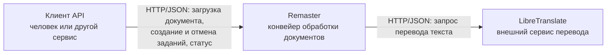
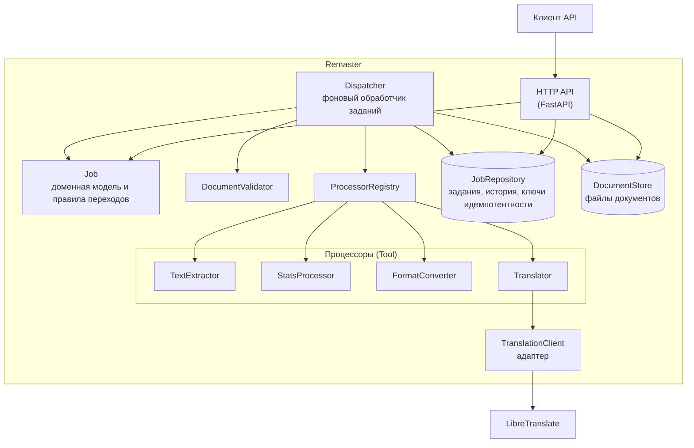
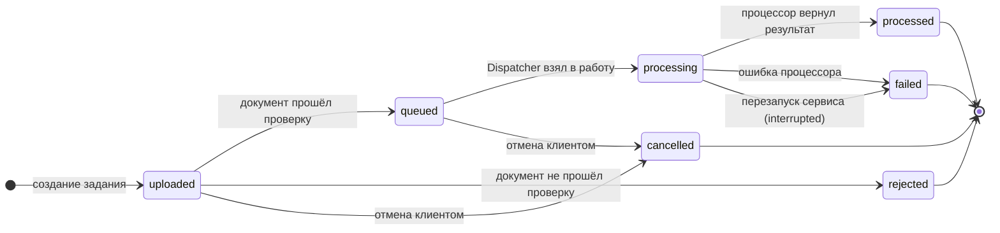

# Архитектура

Документ описывает, из чего состоит сервис обработки документов и как части связаны между собой.
Сценарии и требования - в [requirements.md](requirements.md), контракт API - в [api/openapi.yaml](api/openapi.yaml),
контракт процессора - в [tool-contract.md](tool-contract.md), принятые решения - в [adr/](adr/).

## Схема контекста

Система целиком, её пользователи и внешние системы (уровень Context в C4).

**Что показывают стрелки:** вызовы по сети во время работы. Стрелка идёт от того, кто инициирует запрос,
к тому, кто отвечает.

| Участник | Роль |
|---|---|
| Клиент API | Загружает документы, создаёт задания, узнаёт статус и забирает результат. Пользовательского интерфейса нет - работа через API и Swagger UI |
| Remaster | Наша система: принимает документы и задания, выполняет обработку, хранит результаты и историю |
| LibreTranslate | Внешний сервис перевода. Не под нашим контролем: может отвечать медленно, с ошибкой или мусором |

## Схема компонентов

Что внутри системы и как части вызывают друг друга.

**Что показывают стрелки:** вызовы во время работы - кто к кому обращается. Стрелка от `registry`
к процессорам означает «выдаёт по имени операции», а не прямой вызов процессора из Registry:
процессор вызывает Dispatcher через общий контракт.

Зависимости кода направлены внутрь, к ядру: `Job`, `Dispatcher`, `ProcessorRegistry` и процессоры
не импортируют FastAPI и драйвер БД. Хранилища подключаются через интерфейсы `JobRepository`
и `DocumentStore`; на прототипе - реализации в памяти и на диске, к практике 7 - PostgreSQL.

### Компоненты

| Компонент | За что отвечает | Что скрывает от соседей |
|---|---|---|
| HTTP API | Принимает HTTP-запросы, проверяет формат тела и заголовок `Idempotency-Key`, создаёт задания, отдаёт статус и результат, переводит доменные ошибки в единый формат `{code, message, details}` | HTTP, FastAPI, коды ответов, сериализацию JSON |
| Job | Хранит состояние задания и решает, разрешён ли переход. Недопустимый переход - явная ошибка `invalid_transition` | Таблицу разрешённых переходов: вызывающий код только просит «перейди в X» |
| Dispatcher | В фоне берёт задания из `queued`, получает процессор из Registry, ведёт Job по состояниям, превращает результат или падение процессора в переход Job. При старте переводит зависшие в `processing` задания в `failed` | Порядок шагов выполнения и обработку исключений процессоров. Конкретных процессоров не знает |
| DocumentValidator | Проверяет документ перед обработкой: формат, размер, сигнатура файла. По результату Job переходит в `queued` или `rejected` | Как именно определяется формат (расширение, сигнатура, библиотеки) |
| ProcessorRegistry | По имени операции (`extract_text`, `stats`, `convert`, `translate`) выдаёт процессор. Неизвестное имя - ошибка `unknown_operation` | Список процессоров и способ их регистрации |
| TextExtractor, StatsProcessor, FormatConverter, Translator | Выполняют одну операцию над документом через общий контракт `Processor.run(document, params) -> ProcessingResult` | Библиотеки работы с файлами (pypdf, python-docx), алгоритмы обработки |
| TranslationClient | Обращается к LibreTranslate: timeout, ограниченный retry на таймаут и 5xx, разбор ответа, перевод ответа в наш формат | Протокол и формат ответа LibreTranslate. Если поставщик переименует поле, меняется только адаптер |
| JobRepository | Сохраняет и читает задания, историю переходов и ключи идемпотентности; атомарно меняет состояние только из ожидаемого | Тип хранилища: память, SQLite или PostgreSQL |
| DocumentStore | Сохраняет файлы документов и результаты, выдаёт их по идентификатору | Где и как лежат файлы (диск, том Docker) |

### Как проходит основной сценарий

1. Клиент загружает документ: HTTP API сохраняет файл в `DocumentStore` и возвращает `document_id`.
2. Клиент создаёт задание: HTTP API проверяет запрос и ключ идемпотентности, создаёт Job в `uploaded`,
   сохраняет его в `JobRepository` и сразу отвечает `201`.
3. Dispatcher в фоне берёт задание, вызывает `DocumentValidator`: Job переходит в `queued` или `rejected`.
4. Dispatcher берёт задание из `queued`, переводит его в `processing`, получает процессор из `ProcessorRegistry`
   и вызывает его.
5. Успех - Job в `processed`, результат сохранён. Ошибка или исключение процессора - Job в `failed` с кодом ошибки.

## Диаграмма состояний Job

| Состояние | Смысл | Конечное |
|---|---|---|
| `uploaded` | Задание создано, документ ещё не проверен | нет |
| `queued` | Документ проверен, задание ждёт выполнения | нет |
| `processing` | Процессор выполняет задание | нет |
| `processed` | Успешно завершено, есть результат | да |
| `rejected` | Документ не прошёл проверку | да |
| `failed` | Ошибка при выполнении или перезапуск сервиса во время выполнения | да |
| `cancelled` | Отменено клиентом до начала выполнения | да |

### Запрещённые переходы

Любой переход, которого нет на диаграмме, запрещён. Попытка отклоняется ошибкой `409 invalid_transition`
с текущим состоянием в `details.status`; состояние задания не меняется. Главные случаи:

| Попытка | Почему запрещено | Ответ системы |
|---|---|---|
| Отмена из `processing` | Отмена не останавливает уже работающий процессор | `409 invalid_transition`, задание продолжает выполняться |
| Отмена из `processed`, `rejected`, `failed` | Задание уже завершено | `409 invalid_transition`, результат не меняется |
| Повторный запуск из `processed`, `failed`, `rejected`, `cancelled` | Конечные состояния; повтор - только новым заданием | `409 invalid_transition` |
| Повторный запуск из `processing` | Второй процессор на одно задание - двойная работа | `409 invalid_transition` |
| Результат процессора, пришедший в `cancelled` или `failed` | Опоздавший ответ не должен «оживлять» задание | Ответ игнорируется, в лог - предупреждение, состояние не меняется |
| `uploaded → processing` или `uploaded → processed` | Нельзя обработать непроверенный документ | `409 invalid_transition` |
| Повторная отмена из `cancelled` | Не ошибка: отмена идемпотентна | `200`, состояние не меняется |

Переход выполняется атомарно и только из ожидаемого состояния: если отмена клиентом и взятие в работу
пришли одновременно, выполняется первый переход, второй получает `409 invalid_transition`.
